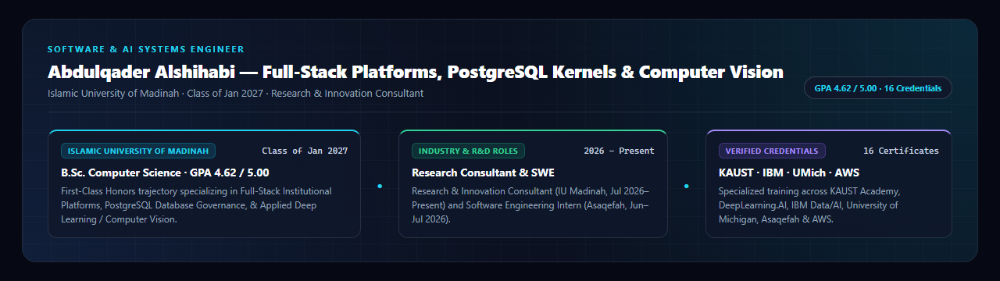
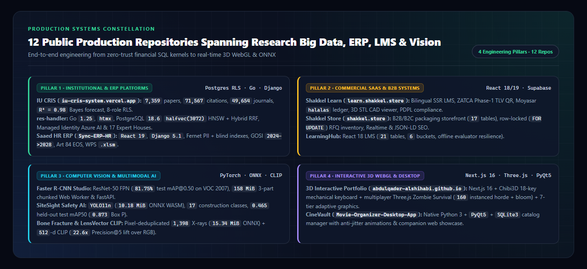
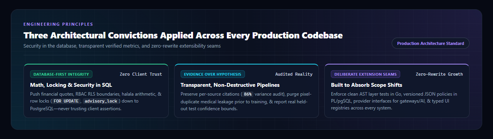

# Abdulqader Alshihabi

**Software & AI Systems Engineer · Full-Stack Platforms (`Go`, `React 19`, `Django 5`, `Next.js 16`), PostgreSQL Kernels & Applied Computer Vision**

---

  

## Engineering Identity & Philosophy

I build **audit-grade full-stack platforms, financial/compliance database kernels, and browser-native AI systems** anchored at the intersection of relational rigor and clean user experience. Across university research analytics, Saudi labor-law payroll engines, bilingual ZATCA-compliant commerce, and client-side ONNX/WebGL runtimes, every system here follows three core standards:

1. **Zero-Trust State & Business Logic in the Database:** Financial ledgers, role isolation (RLS / BOLA), concurrency locks (`FOR UPDATE`, `pg_advisory_xact_lock`), and encrypted PII live inside PostgreSQL—never trusting client calculations.
2. **Forensic Honesty Over Vanity Metrics:** Retaining conflicting source provenance across bibliometrics (`86%` Scopus/OpenAlex divergence), purging exact-pixel leakage before medical X-ray classification (`288` duplicates removed), and benchmarking retrieval models honestly against raw baselines (`22.6x` Precision@5 lift).
3. **Deliberate Extension Seams:** Compile-time AST layer boundaries (`layers_test.go`), immutable JSON bylaw rows (`incentive_policies`), single-source route registries (`navConfig.ts`), and provider interfaces ensure late-stage product shifts require zero core rewrites.

  

---

## Featured Flagship Repositories & Live Deployments

### 1. Institutional Research Intelligence, Enterprise ERP & Commercial SaaS

| System | Core Tech Stack | Verified Scale, Architecture & Security Highlights | Live / Repository |
| :--- | :--- | :--- | :--- |
| **IU CRIS** *(Capstone)* | `React 19`, `TanStack Start` (`Nitro`), `Tailwind v4`, `PostgreSQL` (`PL/pgSQL`, RLS) | **7,359** works · **71,567** citations · **49,654** journals · **`R² = 0.98`** Empirical Bayes forecast · 8 DB roles · Zero-trust `incentive_quote()` | [Live System](https://iu-cris-system.vercel.app/) · [Case Study](https://github.com/Abdulqader-Alshihabi/Islamic-University-CRIS) |
| **Research Portal (`res-handler`)** | `Go 1.25.4`, `Chi v5`, `htmx`, **`PG 18.6` `pgvector`**, Azure OpenAI & Speech | `halfvec(3072)` HNSW + exact cosine · Hybrid RRF (`rrfK=60`) · **Baheth** anti-hallucination AI · **17 Expert Houses** · `layers_test.go` AST firewall | [Architecture Showcase](https://github.com/Abdulqader-Alshihabi/res-handler) |
| **Saaed (ساعد) HR ERP** | `React 19`, `TanStack v5`, **`Django 5.1`** (`14` apps), `PG 16`, `Redis 7` | Fernet PII + keyed HMAC blind index · `2024->2028` GOSI & Art 84 EOS · Maker-Checker RAM `.xlsm` WPS · MHRSD Nitaqat gates · **>=80%** `diff-cover` CI | [Architecture Showcase](https://github.com/Abdulqader-Alshihabi/Sync-ERP-HR) |
| **Shakkel Corporate LMS** | `React 19`, `TanStack Router`, `Three.js` (`STL`), `Supabase` (`7` Deno Edge) | Integer `halalas` ledger · Moyasar verify/webhook · **ZATCA Phase-1 TLV QR** · Stripped-key exam engine · **`shkl-`** certs · **Saudi PDPL** erasure | [Live LMS](https://learn.shakkel.store/) · [Showcase](https://github.com/Abdulqader-Alshihabi/shakkel-learn) |
| **Shakkel Industrial Store** | `React 18.3`, `Vite 5`, `Supabase` (`17` tables), `Resend`, JSON-LD SEO | Zero-flash pre-mount Arabic RTL · 20-level category tree · `FOR UPDATE` stock-locked B2B RFQ lifecycle · Live Realtime WebSockets | [Live Store](https://shakkel.store/) · [Showcase](https://github.com/Abdulqader-Alshihabi/Industrial_Shakkel) |
| **LearnHub LMS** | `React 18.3`, `TS 5.8`, `TanStack Query v5`, `Supabase` (`21` tables, `6` buckets) | Enrollment-guarded private media buckets · 5-step authoring approval log · Timed MCQ quizzes · Graceful offline evaluator seed mode | [Live Demo](https://abdulqader-alshihabi.github.io/LearningHub/) · [Repo](https://github.com/Abdulqader-Alshihabi/LearningHub) |

### 2. Applied Computer Vision, Deep Learning & Interactive 3D Systems

| System | Core Architecture | Verified Metrics & Engineering Delivery | Live / Repository |
| :--- | :--- | :--- | :--- |
| **3D Interactive Portfolio** | `Next.js 16.2`, `React 19.2`, **`Chibi3D`**, **`Three.js 0.185`**, `GSAP`, `Lenis` | Procedural 18-key mechanical keyboard + 16-slot odometer · Code-split **20 Hz co-op 3D Zombie game** (`160` instanced horde) · 7-tier adaptive FPS · `16` Certs & Doodle CV | [Visit Portfolio](https://abdulqader-alshihabi.github.io/) · [Repo](https://github.com/Abdulqader-Alshihabi/Abdulqader-Alshihabi.github.io) |
| **Faster R-CNN Detection** | `PyTorch`, `ResNet-50 FPN` (`41.40M` params), `ONNX`, `FastAPI` | **81.75% Test mAP@0.50** (`4,952` PASCAL VOC 2007 images, `24.45ms` A100) · `158 MiB` 3-part SHA-256 chunked Web Worker · `FrozenBatchNorm2d` eps restore | [Live Studio](https://abdulqader-alshihabi.github.io/Faster-RCNN-Object-Detection/) · [Repo](https://github.com/Abdulqader-Alshihabi/Faster-RCNN-Object-Detection) |
| **SiteSight Safety AI** | `YOLO11n` (`2.60M` fused params), `ONNX Runtime Web v1.31.1` WASM | `17` construction classes · **`0.465` held-out test mAP50** (`0.873` Box P, `4.7ms` A100) · Non-blocking `10.18 MiB` background WASM hydration + audit JSON export | [Live Safety App](https://abdulqader-alshihabi.github.io/SiteSight-Safety-Vision/) · [Repo](https://github.com/Abdulqader-Alshihabi/SiteSight-Safety-Vision) |
| **Bone Fracture Classifier** | `EfficientNet-B0` (`4.02M` params), `15.34 MiB` ONNX (`7.75e-7` diff) | Post-EXIF deduplication purged **288 duplicates & 124 label conflicts** (`1,398` clean X-rays) · **49.07% test acc** (`0.465` macro-F1, `95% CI`) · `verify_project.py` gate | [Live Viewer](https://abdulqader-alshihabi.github.io/Bone-Fracture-Classifier/) · [Repo](https://github.com/Abdulqader-Alshihabi/Bone-Fracture-Classifier) |
| **LensVector CLIP Search** | `OpenAI CLIP ViT-B/32 (q8)`, `512`-d `Float32Array` Binary Matrix | `3.91 MiB` (`2,000` vector) zero-DB matrix · **`27.1%` Precision@5 / `59.0%` Hit@5** (`22.6x` Precision@5 lift over RGB baseline) · Pinned Web Worker `q8` parity | [Live Search](https://abdulqader-alshihabi.github.io/Visual-Similarity-Search/) · [Repo](https://github.com/Abdulqader-Alshihabi/Visual-Similarity-Search) |
| **CineVault Movie App** | `Python 3`, **`PyQt5 >= 5.15`**, **`SQLite3` (`movies.db`)**, HTML5 Showcase | Zero-jitter `150x150` container avatar animations · Dual optional SHA-256 / 1-click profiles · Rollback-safe user delete · Companion static web showcase | [Web Showcase](https://abdulqader-alshihabi.github.io/Movie-Organizer-Desktop-App/) · [Repo](https://github.com/Abdulqader-Alshihabi/Movie-Organizer-Desktop-App) |

---

  

## Technical Matrix

- **Languages & Core Systems:** `TypeScript`, `Python`, `Go (1.25)`, `SQL (PL/pgSQL)`, `JavaScript (ES6+)`, `HTML5 / CSS3`, `Java`
- **Web, 3D & Desktop UI:** `React 19`, `Next.js 16`, `TanStack Start / Router / Query v5`, `Three.js` / `React Three Fiber`, `Chibi3D`, `GSAP`, `Lenis`, `Motion`, `Tailwind CSS v4`, `htmx`, `Tiptap`, `PyQt5`
- **Backend, Crypto & Data:** `Django 5 & DRF`, `Chi Router`, `FastAPI`, `PostgreSQL 16/18` (`RLS`, `pgvector`, `pg_trgm`, `goose`), `Supabase` (`Deno Edge Functions`), `Redis 7`, `Argon2`, `cryptography.fernet`, `Docker` & `Azure Container Apps`
- **AI & Computer Vision:** `PyTorch`, `Torchvision`, `Ultralytics YOLO11`, `OpenAI CLIP`, `ONNX Runtime` & `ONNX Runtime Web (WASM SIMD)`, `Scikit-learn`, `Azure OpenAI` & `Speech Foundry`

---

**Open to impactful Software Engineering, AI Systems & Full-Stack R&D opportunities**

[Explore Interactive 3D Portfolio](https://abdulqader-alshihabi.github.io/) &nbsp;|&nbsp; [LinkedIn](https://www.linkedin.com/in/abdulqader-alshihabi-859b19260) &nbsp;|&nbsp; [WhatsApp (+966 58 273 3968)](https://wa.me/966582733968) &nbsp;|&nbsp; `abdulqader.moh.2003@gmail.com`

